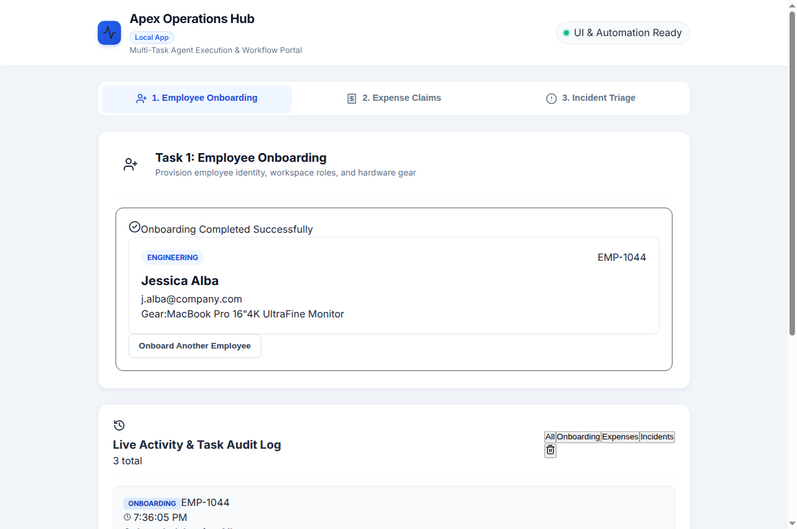
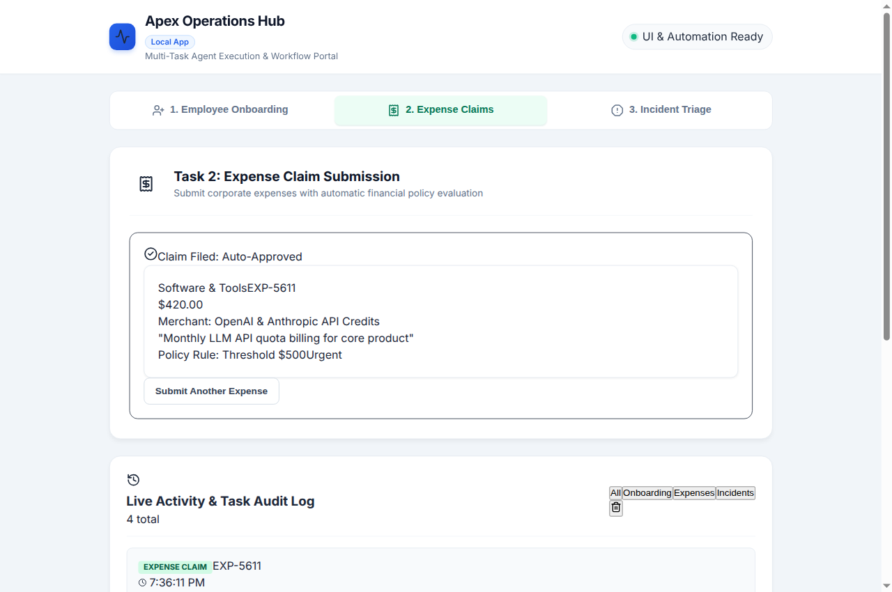
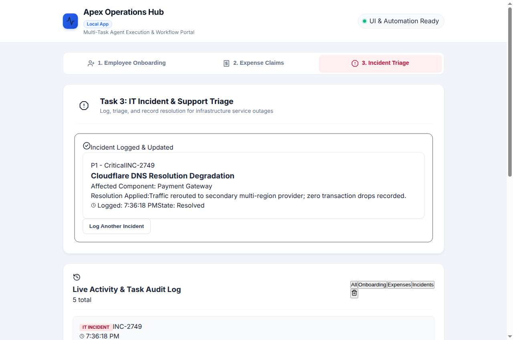
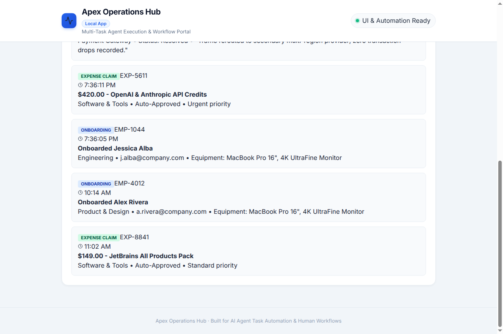

# 🚀 Apex Operations Hub · AI Agent & Multi-Task Web Application

> **An Agent-First Operations Platform powered by Google Cloud Vertex AI (ADK), Native Firestore, and Playwright Browser Automation.**

Apex Operations Hub combines an autonomous AI agent (**`apex-ops-agent`**) with a modern **React application (`task-hub-app`)** to manage and execute high-impact corporate operations workflows:
1. **Employee Onboarding** (Identity provisioning, department assignment, and hardware equipment bundles)
2. **Expense Claims Management** (Automatic financial policy rules & manager review routing for expenses > $500)
3. **IT Incident & Support Triage** (Outage logging, severity classification, and infrastructure mitigation recording)
4. **Live Activity & Task Audit Trail** (Real-time logging of all completed operations across the enterprise)

The agent operates in two modes:
* **Backend API & Data Mode**: Directly querying and writing records to **Google Cloud Firestore**.
* **Autonomous UI Driver Mode**: Using **Playwright** to navigate, fill forms, submit tasks, and read feedback directly on the live React web UI.

---

## 📸 Visual Demos

| Task 1: Employee Onboarding | Task 2: Expense Claim Auto-Approval |
|:---:|:---:|
|  |  |

| Task 3: IT Incident Triage | Live Activity & Audit Log |
|:---:|:---:|
|  |  |

---

## 🧩 Architecture

```
┌────────────────────────────────────────────────────────┐
│                   User / Operator                      │
└──────────────────────────┬─────────────────────────────┘
                           │ Natural language queries
                           ▼
┌────────────────────────────────────────────────────────┐
│        Apex Operations Agent (Google ADK)              │
│        Model: Gemini 2.5 Flash                         │
└────────────┬─────────────────────────────┬─────────────┘
             │                             │
             │ Browser Automation          │ Database I/O
             ▼                             ▼
┌──────────────────────────┐  ┌──────────────────────────┐
│     React Web App        │  │  Google Cloud Firestore  │
│  (task-hub-app @ :5173)  │  │  (Collection: operations)│
│  • Onboarding            │  │  • EMP-*, EXP-*, INC-*   │
│  • Expense Claims        │  └──────────────────────────┘
│  • IT Incident Triage    │
│  • Live Audit Feed       │
└──────────────────────────┘
```

---

## 🛠️ Step-by-Step Guide: Running on a New System

Follow these steps to set up and run this project from scratch on any computer or server.

### 1. Prerequisites
Ensure the target system has:
* **Git**: `git --version`
* **Node.js (v18+) & npm**: `node --version`
* **Python (3.11 – 3.13)**: `python3 --version`
* **Google Cloud SDK (`gcloud`)**: [Install instructions](https://cloud.google.com/sdk/docs/install)
* **Google Chrome** (or Chromium)

---

### 2. Clone the Repository
```bash
git clone https://github.com/dgavini/buildwithgemini-apex-ops-agent.git
cd buildwithgemini-apex-ops-agent
```

---

### 3. Start the React Web Application (`task-hub-app`)
In **Terminal 1**:
```bash
cd task-hub-app
npm install
npm run dev
```
* The web app will start on **`http://localhost:5173`**.
* Keep this terminal running.

---

### 4. Authenticate with Google Cloud
In **Terminal 2**, authenticate with your GCP project so the agent can access Gemini and Firestore:
```bash
gcloud auth login
gcloud auth application-default login
gcloud config set project YOUR_PROJECT_ID
```

---

### 5. Set Up the Python Agent (`apex-ops-agent`)
In **Terminal 2**:
```bash
cd apex-ops-agent

# Install dependencies using virtual environment:
python3 -m venv .venv
source .venv/bin/activate
pip install -e .
playwright install chromium
```
*(Alternatively, if using `agents-cli`: `uv tool install google-agents-cli && agents-cli install`)*

---

### 6. (Optional) Seed the Firestore Backend
To populate initial task records in Firestore:
```bash
python seed_firestore.py
```

---

### 7. Run the Agent & Automations

#### A. Interactive Natural Language Execution (`agents-cli run`)
```bash
# Query Firestore tasks:
agents-cli run "List all operations tasks from Firestore"

# Drive the React Web UI to onboard an employee:
agents-cli run "Submit an employee onboarding task on the web UI for Bruce Wayne in Security with email b.wayne@company.com with a laptop and monitor."

# Drive the React Web UI to submit an expense claim:
agents-cli run "Submit an urgent expense claim on the web UI for $850.00 to AWS Cloud Infrastructure for server hosting"
```

#### B. Run the On-Screen Visual Demo Script
Watch Chrome automatically launch on your screen, navigate the UI, fill the forms, and complete all 3 tasks with visual pauses:
```bash
python task-hub-app/run_live_demo.py
```

#### C. Query the Deployed Cloud Agent via A2A
The agent is also deployed live to **Google Cloud Vertex AI Agent Runtime**. Any machine with `gcloud` authenticated can invoke it remotely over the **A2A protocol**:
```bash
agents-cli run "List all operations tasks from Firestore" \
  --url https://us-east1-aiplatform.googleapis.com/reasoningEngines/v1/projects/994949497408/locations/us-east1/reasoningEngines/3127845598720425984/api \
  --mode a2a
```

---

## ☁️ Cloud Deployment Details

* **Platform:** Google Cloud Vertex AI Agent Runtime (Reasoning Engine)
* **Region:** `us-east1`
* **Protocol:** Agent-to-Agent (A2A v1.0)
* **Resource ID:** `projects/994949497408/locations/us-east1/reasoningEngines/3127845598720425984`
* **Agent Card Endpoint:** [Agent Card JSON](https://us-east1-aiplatform.googleapis.com/reasoningEngines/v1/projects/994949497408/locations/us-east1/reasoningEngines/3127845598720425984/api/a2a/app/.well-known/agent-card.json)

---

## 📂 Repository Structure

```
├── README.md                       # Complete Project Documentation & Run Guide
├── project_brief.md                # Architectural Design Brief
├── apex-ops-agent/                 # ADK AI Agent
│   ├── app/
│   │   ├── agent.py                # Root Agent definition & tool binding
│   │   ├── browser_tools.py        # Playwright UI automation tools
│   │   └── firestore_tools.py      # Firestore read/write operations tools
│   ├── seed_firestore.py           # Database initial seeder script
│   ├── pyproject.toml              # Python dependencies & build config
│   └── agents-cli-manifest.yaml    # Agent Runtime deployment manifest
└── task-hub-app/                   # React Frontend Web Application
    ├── src/
    │   ├── components/
    │   │   ├── OnboardingTask.jsx  # Task 1: Employee Onboarding
    │   │   ├── ExpenseTask.jsx     # Task 2: Expense Claims
    │   │   ├── IncidentTask.jsx    # Task 3: Incident Triage
    │   │   └── ActivityLog.jsx     # Real-time task audit feed
    │   └── App.jsx                 # Main layout & tab router
    ├── run_live_demo.py            # Playwright visual runner (Scenario 1)
    ├── run_demo_2.py               # Playwright visual runner (Scenario 2)
    ├── run_demo_task3.py           # Playwright visual runner (Task 3 focus)
    └── TASK_AUTOMATION_GUIDE.md    # In-depth selectors & automation doc
```

---

## 📄 License
Apache-2.0
